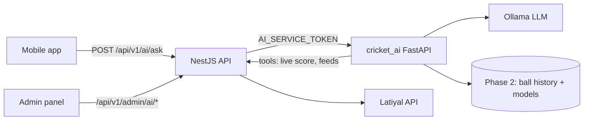

# Cricket AI: what to build next (phased)

## Where you are now
- The backend (NestJS) already has live scores (worker plus Redis), all 51 Latiyal feeds at `/api/v1/feeds/*`, `MATCH_FINISHED` detection in [backend/src/live-score/live-score-sync.service.ts](backend/src/live-score/live-score-sync.service.ts), and an admin panel.
- **The gap:** the database stores match metadata only ([backend/prisma/schema.prisma](backend/prisma/schema.prisma) `Match`), with no ball-by-ball history. Training your own models needs that history, so Phase 1 starts without it.
- **Latiyal already gives you a lot:** `matchProbHistory` (win %), `matchOverHistory`, `commentary`, `scorecardByMatchId`, `headToHeadByTeamId`, `venueScoringPattern` and more. Phase 1 uses these as tools for the AI.

## How it connects

How the pieces talk to each other:
- **The app never talks to the AI service directly.** It goes through NestJS, so the existing rate limiting, error envelope and single API host still apply.
- **The AI service reads data only from your backend**, at `/api/v1/matches/{id}` and `/api/v1/feeds/*`. It never calls Latiyal itself, so the Latiyal token stays only in `backend/.env`.
- **The AI service and NestJS share a secret, `AI_SERVICE_TOKEN`, in both directions.** NestJS sends it when calling the AI service. The AI service sends it on its own data requests, and the throttler lets those through, so the AI's lookups never use up per-IP limits.

## Phase 1: AI chat on live data
1. **Create the `cricket_ai/` service (Python FastAPI):**
   - `config.py` reads `.env`: `BACKEND_URL`, `AI_SERVICE_TOKEN`, `OLLAMA_URL`, `LLM_MODEL`.
   - `backend_client.py` fetches the live match and the feeds, with a short cache.
   - `estimators.py` gives simple, clearly labelled estimates:
     - projected score from run rate and the last 5 overs;
     - "chance of X runs by over N" from the spread of recent per-over runs;
     - win % taken directly from Latiyal's `matchProbHistory`.
   - `agent.py` runs the Ollama tool-calling loop with these tools: `get_live_match`, `win_probability`, `project_score`, `chance_to_reach`, `head_to_head`, `venue_stats`, `scorecard`. Its rules:
     - every number comes from a tool;
     - it answers in English, Hindi or Marathi;
     - it always says "% chance" and never promises a result.
   - `main.py` has `POST /ask`, `GET /match/{id}/insights` and `GET /health`.
2. **Choose the LLM:** your GPU isn't confirmed yet, so `LLM_MODEL` is a setting. The default is `qwen2.5:7b-instruct`, which supports tool calling, handles Hindi well and runs on about 8 GB. Change it to a 14B model on a 16–24 GB GPU without touching code.
3. **Add an AI module to the backend** (`backend/src/ai/`):
   - `POST /api/v1/ai/ask` takes `{ matchId, question, language }` and returns `{ answer, numbers }`. It has its own stricter limit with `@Throttle`, for example 10 per minute per IP, because LLM answers are expensive.
   - `GET /api/v1/ai/matches/{id}/insights` returns ready-made cards for app screens, cached about 10 seconds with `SingleFlightCache`.
   - New env settings `AI_SERVICE_URL`, `AI_SERVICE_TOKEN` and `AI_ENABLED`, validated in [backend/src/config/env.validation.ts](backend/src/config/env.validation.ts). The AI endpoints return 503 when the AI is disabled or down.
   - The throttler guard skips requests that carry a valid internal token.
4. **Add an "AI assistant" admin page** (`admin/src/app/(panel)/ai/page.tsx`, linked from [admin/src/components/layout/sidebar.tsx](admin/src/components/layout/sidebar.tsx)). It shows whether the service is up, the model name and average answer time, and has a test chat box where you pick a live match and ask a question.
5. **Deployment:**
   - Install Ollama (`ollama pull <model>`).
   - Add a `cricket-ai` (uvicorn) entry to [ecosystem.config.cjs](ecosystem.config.cjs), bound to `127.0.0.1`.
   - Document it in `docs/DEPLOYMENT.md`, and add the AI section to `docs/API_CONTRACT.md`.
6. **Tests:**
   - Python, with the LLM mocked: tool routing, the estimators, the language rule, and the "100 runs in 6 overs" example end to end.
   - NestJS e2e: proxying, the 503 when disabled, the throttle, and the token check.

## Phase 2: your own models that learn after every match
1. **`history.py`:** a SQLite store with one row per ball and the score state at that ball. Load the free Cricsheet ball-by-ball data first (IPL, T20I, ODI). Add `add_match()` for your own matches.
2. **Ingest finished matches:** a scheduler job checks `recentMatches` every 10 minutes for matches it hasn't ingested yet. It takes their balls from Latiyal `commentary`, plus the scorecard, through the backend. This needs to be checked first on a real finished match: does `commentary` contain every ball?
3. **`features.py` and `models.py`:** LightGBM models for win probability, final-score ranges (10th, 50th and 90th percentile) and runs by over N. Each version is saved in `models/vN/` with a `metrics.json`.
4. **`retrain.py`:** ingest the new balls, retrain, then test on the last 50 matches. Switch to the new version only if it is at least as accurate as the old one. It can also be run by hand.
5. **Use your own models:** the agent's tools switch from the Phase 1 estimators to your models. Latiyal's win % stays as a cross-check.
6. **Admin "Models" tab:** model versions with their accuracy, a "Retrain now" button and the time of the last ingest, served through `/api/v1/admin/ai/models` and `/api/v1/admin/ai/retrain`.

## What I need from you before Phase 2
- The GPU model and its memory, to pick the final LLM size.
- Confirmation that Cricsheet data is acceptable as the starting history.