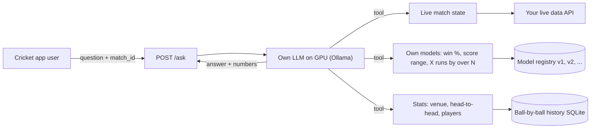
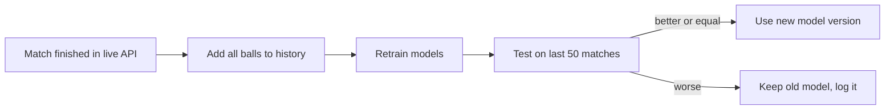

# Your own Cricket AI (trains after every match)

## Answer: yes, possible - and fully yours
Two parts, both running on your GPU server:

1. **Prediction brain = your own ML models** (LightGBM on ball-by-ball data). These are what "learn": after every finished match the new balls are added and the models retrain automatically. A new model is used only if it is at least as accurate as the old one on recent matches (so a bad retrain can never make answers worse).
2. **Chat = your own open-source LLM** (Qwen or Llama family, served by Ollama on your GPU). It does not memorise matches; it reads the question, calls your models/data as tools, and writes the answer. Match facts always come from your database, so answers are current even right after a ball is bowled.

## Assumptions (change if wrong)
- Live API: one small adapter converts its JSON to our `MatchState`; I need ONE sample JSON of a live match and of a finished match.
- Starting history: free **Cricsheet** ball-by-ball data (IPL, T20I, ODI, domestic T20s); your own database can be added later through `history.add_match()`.
- New folder `cricket_ai/` in this workspace, Python + FastAPI.
- LLM: a tool-calling instruct model that fits your GPU (e.g. 7-14B for a 16-24 GB GPU), set by `LLM_MODEL` in `.env`, so you can switch models without code changes.

## What gets built
- [cricket_ai/app/live.py](cricket_ai/app/live.py) - live adapter, 5-10 s cache, `MatchState` (teams, format, innings, runs, wickets, balls, target, venue, last 12 balls, batters/bowler), detects "match finished".
- [cricket_ai/app/history.py](cricket_ai/app/history.py) - SQLite table of every ball with the score state at that moment; Cricsheet bootstrap; `add_match()`; queries for venue averages, head-to-head, player form.
- [cricket_ai/app/features.py](cricket_ai/app/features.py) - one feature row per ball: format, innings, balls left, runs, wickets, current/required run rate, last-5-over runs, venue average, team strength (recent form).
- [cricket_ai/app/models.py](cricket_ai/app/models.py) - LightGBM models:
  - **win probability** (classifier, per ball state)
  - **final score range** (quantile regressors 10/50/90)
  - **runs by over N** -> your "100 in 6 overs" question = probability that runs at over 6 >= 100 from the current state
  - versioned files in `models/vN/` + `metrics.json`
- [cricket_ai/app/retrain.py](cricket_ai/app/retrain.py) - after-match pipeline (ingest, retrain, evaluate, promote/keep), run by an APScheduler job that checks the live API for finished matches, plus `python -m app.retrain` by hand.
- [cricket_ai/app/agent.py](cricket_ai/app/agent.py) - Ollama tool-calling loop (OpenAI-compatible API) with tools `get_live_match`, `win_probability`, `project_score`, `chance_to_reach`, `head_to_head`, `venue_stats`, `player_stats`. Rules: numbers only from tools, reply in the user's language, always as "% chance", never a sure result.
- [cricket_ai/app/main.py](cricket_ai/app/main.py) - FastAPI: `POST /ask {match_id, question, language}` -> `{answer, numbers}`; `GET /match/{id}/insights` (ready cards for app screens); `POST /admin/retrain`, `GET /admin/models` (versions + accuracy).
- `cricket_ai/docker-compose.yml` - API + Ollama with GPU, so the server setup is one command.
- [cricket_ai/ui.py](cricket_ai/ui.py) - Gradio test page; [cricket_ai/tests/](cricket_ai/tests/) - offline tests (fake LLM, small data sample).

## Later (optional)
- Fine-tune (LoRA) the LLM monthly on real user questions/answers for better Hinglish/Marathi chat. Not per match: per-match learning happens in the prediction models.

## What I need from you
- One sample JSON response of a LIVE match and of a FINISHED match from your API (and docs link if any).
- Your GPU model / memory (to pick the right LLM size).
